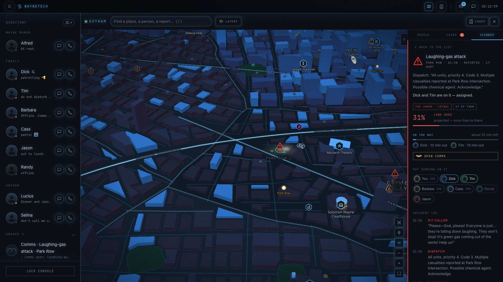
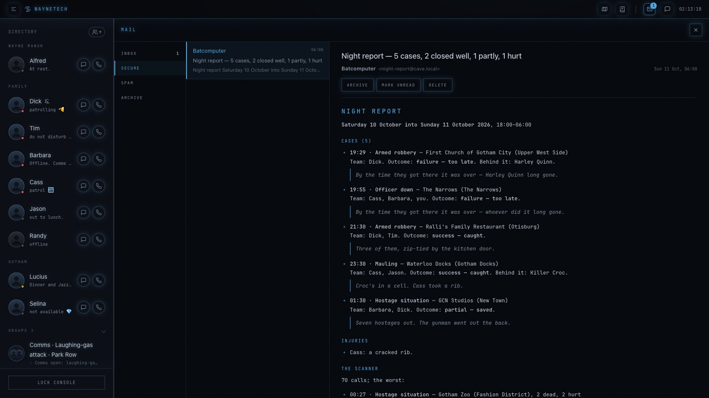
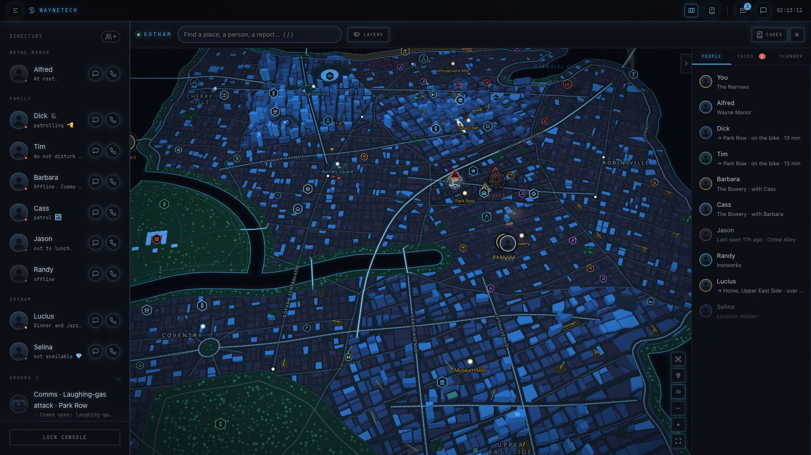
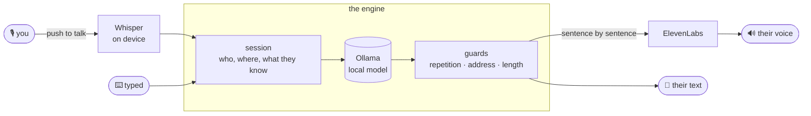

<div align="center">

# 🦇 WayneTech Console

**Gotham, running on your Mac.**
Call Alfred. Text Dick. Get left on read by Jason. Watch the city move on a live holographic map, and work the cases off the police scanner.


</div>

You're Bruce Wayne. The console is your phone: ten people who each have their own voice, memory, schedule and opinions of you, and a city that carries on whether or not you're watching. Everything except the voices runs on your machine: the model thinks locally through [Ollama](https://ollama.com), and [ElevenLabs](https://elevenlabs.io) does the speaking.

> [!NOTE]
> This is a hobby project and an ongoing experiment in making characters feel like people rather than chatbots. Nothing they say is scripted: their days, texts, moods, the dispatches on the scanner and how a case ends are all generated, inside rules that keep them consistent.

<details>
<summary><b>📖 Contents</b></summary>

- [Meet the cast](#-meet-the-cast)
- [What it does](#-what-it-does)
- [Gotham, the map](#%EF%B8%8F-gotham-the-map)
- [Things to try](#-things-to-try)
- [Setup](#-setup)
- [Keys](#%EF%B8%8F-keys)
- [How it works](#-how-it-works)
- [Making it yours](#-making-it-yours)
- [Evaluation](#-evaluation)
- [Development](#%EF%B8%8F-development)
- [Notes and limitations](#-notes-and-limitations)

</details>

---

## 🎭 Meet the cast

| | Contact | Who they are to you | On the phone |
|---|---|---|---|
| 🎩 | **Alfred Pennyworth** | Raised you. Runs the Manor, and the case board. | "Master Bruce." Dry, brief, warm underneath. Sees everyone's location, like you. |
| 🤸 | **Dick Grayson**, *Nightwing* | The first Robin. Blüdhaven's now. | Lowercase bursts, emoji, the one who checks in after a bad call. |
| 🔍 | **Tim Drake**, *Robin* | The detective. | Methodical, dry, won't let you spiral. |
| 💻 | **Barbara Gordon**, *Batgirl / Oracle* | A peer who commands. | Exact punctuation. Watches the scanner and the map. |
| 🩰 | **Cassandra Cain**, *Orphan* | Reads bodies, not words. | Says little. Sees everything. |
| 🔴 | **Jason Todd**, *Red Hood* | Came back angry. | "k". Doesn't share where he is. |
| 🦅 | **Randy Wayne**, *Batwing* | Your son, estranged, flying alone. | Leaves you on read more often than not. |
| 🏢 | **Lucius Fox** | Runs Wayne Enterprises; builds your toys. | "Mr. Wayne." A measured sentence, a firm ethical line. |
| 🐈‍⬛ | **Selina Kyle**, *Catwoman* | Randy's mother. | Her own woman, on her own schedule. Knows who you are; nobody else's mask. |
| 🚨 | **Jim Gordon**, *Commissioner* | Your partner for years, and Barbara's father. Has never asked who you are. | "Batman." Gruff, tired, by the book. Rings when the city's on fire. |

Each one is a JSON profile in [`wayne/contacts/profiles/`](wayne/contacts/profiles/), and adding another is a file, not a code change (see [Making it yours](#-making-it-yours)).

**Not everyone knows everything.** Jim knows Batman and the masks, never a face: to him you're Batman, Barbara is Batgirl, and Dick is Nightwing. Selina knows who you are and nobody else. Put Jim on a group call or in a group chat and everyone on it is careful: no names, no "Bruce", nothing about the cave. Each contact's knowledge is set in the Codex (*What they know*), and the story can change it.

## ✨ What it does

<table>
<tr><td width="50%" valign="top">

### 📞 Calls
- **Hold <kbd>Space</kbd> to talk**, or type; the mic button mutes you, and they know you've gone quiet. Talk over them and they stop.
- **Speech starts in about half a second.** The turn is read ahead while you're still talking, sentences are voiced as the model writes them, and the words appear in time with the voice.
- **Voices that fit the moment**, and the sound of where they are. Woken by your call, they yawn; mid-fight, they grunt and cut off; on a stakeout, they whisper. They talk the way people talk on the phone, unpolished and short, each in their own register, and how much feeling is in it depends on what's happening. Stage directions are performed, never shown.
- **Their world, in the background.** A hundred kinds of place and 170 sounds, kept low and occasional so they never talk over anyone: a horn beside them, a siren going past, a train far off, the crowd under a busy street, rain on the windows, the bag in a boxing gym, a games night at Dick's. They hear it too, so "what was that?" gets an answer, and on a group call everyone hears what came down Dick's phone. Each person's ring moves with their room. ([The full list](docs/soundscape.md).)
- **Relationships that move.** Warmth and trust shift slowly, hurts fade, and each of them remembers what happened, in their own words: you woke Dick three mornings running, nobody came when Tim's case went bad, you went yourself. They bring it up, answer slower, ghost, go dark on the map or warm up, each by their nature. Alfred never leaves. The Codex shows where you stand, in words.
- **Life interrupts.** Someone at the door and they mute for a minute, then come back with what it was. Someone walks in on the call and you hear them in the background; someone with company steps away to talk to you alone.
- **A ring that means something.** It covers the model warming up; sleeping ones ring out, and they call you back. Whether they pick up depends on what they're doing, the way it would for anyone. Alfred in the garden answers. Dick on his way to a case answers, and at the scene maybe, about the case. Mid-fight or mid-training, nobody does.
- **Group calls**, you plus seven, each with a visualiser of their own, answering in a few seconds. *"Dick, get Tim on"* rings Tim; everyone hears who declined, who joined and who left. While someone's ringing, the others talk among themselves; people talk over each other and sort it out, and you can jump in any time. **One phone per room**: ring Dick while Tim's with him and Tim's on his speaker, on Dick's seat, and goes when Dick does.

</td><td width="50%" valign="top">

### 💬 Texts and group chats
- **Read receipts at their pace, both ways.** Seconds if their phone's in hand, hours if they're on patrol, never if they're Randy in a mood. Typing dots, then one message or three in a row, in their own style. They can see when you've read theirs, too.
- **Left on read, chased, or ghosted**, depending on who it is — and whether you read it or never opened it.
- **Moods in waves.** Phones ride the city's rhythm (the commute, the evening scroll, the dead small hours) and spells of their own: a flowing hour, then a dry afternoon of one-word answers.
- **Replies that quote.** Reply to one message in particular; they quote-reply too, to you or to each other.
- **Group chats** that live without you. They answer each other, go quiet when everyone's asleep, chase a question nobody's read, and take a private aside to your DMs.
- **@tags that ping.** `@Tim`, `@everyone`, and `@Bruce` lights up *your* screen with its own tone and badge.
- **Emoji and reactions.** A picker in the composer, reactions from a hover button. Reacting is a habit of theirs, not a reflex: Alfred almost never, Cass more than she writes, and a 👍 can be the whole answer.
- **Texting like people text.** Caps when they're yelling, "HAHAHA", "bro", each in their own slang (Jason gets a lot out of Dick's name). The odd typo, fixed with a `*` or just left; "sorry, I meant Thursday" when they mix something up. Either of you can **edit** a sent message (the pencil on hover), and it shows *Edited*.

</td></tr>
<tr><td valign="top">

### 🗓️ Their lives
- **A day of their own**, planned each morning by the model: sleep, work, patrol, errands, a film they wanted to catch — weekdays, weekends and the holidays (Columbus Day, Halloween, Christmas Eve) as Gotham lives them.
- **Where they are** comes from what they're doing, and agrees for everyone. If Barbara's patrolling with Cass, they're in the same place on the map, on the hover card and in what they say. When it changes, they **travel** there by road, over the bridges, as long as it takes.
- **Days of their own.** Nobody patrols at noon unless you ask: Lucius is at the office, Barbara at the lab, Randy at the hangar. Each has a week too (Dick's trapeze nights, Lucius's Saturday golf, dinner at the Manor every other Sunday) and friends of their own beyond the family.
- **Plans that get kept.** "Everyone, the Silver Comet, Saturday at 7?" Each answers their own way, and on the night the ones who said yes are there.
- **Gotham's own news**, every morning: the Gazette's crime desk, the mayoral race, the Knights, Jack Ryder ranting on GBS, which they bring up the way people do.
- **They get in touch first.** They report back when they said they would, check in when a call worried them, close a case and tell you how it went, or text because something reminded them of you.
- **Hobbies that stay current.** What they follow is searched daily, so three months from now they've seen the new season too.

</td><td valign="top">

### 🚨 The city
- **A police scanner** with a steady stream of reports drawn from each district's own trouble: Crime Alley far more than the Upper East Side, and three times busier at night. Knife and gang crime between named crews, domestics, overdoses, and under it the monsters' work, only when they're loose. Every report has its dead and hurt, which change as the call goes on; dispatches and incident logs are written by the model, quote people as they talk, and some are as grim as Gotham gets.
- **Calls that turn and move.** A robbery becomes a getaway on real roads, a snatch a foot chase, a bar fight a stabbing. Crews have numbers (Bane brings thirty), and whoever's sent cuts a getaway off where they can get ahead of it.
- **Cases with odds.** Put someone on a report from the map, or just tell them in conversation. Every call shows its odds as the Batcomputer reckons them, with GCPD's own under them (the family never makes it worse than nobody going), and each free member's button says what sending them would make it, or that they'd be too late. Endings are graded lives first: success, partial, failure. Rogues who get away come back worse; a capture ends the run.
- **Hearsay.** What one of them hears may reach another, with who said it.
- **Secrets that stay secret.** Every fact about you is tagged with who knows it, so Lucius never learns who's under the Batwing mask. Jim sees the city the way GCPD does (the scanner, which masks were on which scene, the cases closed) and never a face.
- **Jim calls.** A major call on the scanner or a breakout with nobody on it, and he may ring you first.
- **The Codex** (<kbd>C</kbd>): everyone in Bruce's world and every rogue as a file — vital details, a biography in Bruce's own words that you can rewrite (yours is his mission, in his voice), where each rogue is now (loose, in custody, Arkham, Blackgate), how they work, their weakness and your contingency — and every place on the map. Drop a picture on a face to give it one.

</td></tr>
<tr><td valign="top">

### 🦇 The family at work
- **Patrols on a roster.** Sectors per two-hour watch, the worst of the city first, Dick and Tim or Barbara and Cass paired some nights, a lead followed where the same crew is on the scanner again. They run the roofs (fast on the lines, a sprint on the tops) and watch from each vantage a while; a call nearby, and they go.
- **Getting there like Batman.** The fastest plausible way in the suit: grapple lines, the bike, Randy flying, your Batmobile. You go as Batman to a case or by night and as Bruce Wayne by day, to any pin or place, or to one of them and with them from then on.
- **The Batwing is yours alone.** Call it and it comes; it drops you anywhere, lifts one of the family on the way, and sweeps the city as a drone till dawn.
- **They go to one another.** Ask Tim to help Dick, however you put it, and it's his to take, question or turn down; if he goes, he's on Dick's case with him or at his side.
- **Their night, on record.** Each keeps a diary the console writes as it happens: set off, got there, who they were with and who left for where, the cases and how they ended. Ask what they were just doing and they know, and so does whoever was with them.
- **Committed on scene.** In the middle of a case, nobody (you included) walks off it; on the way, you can change your mind.
- **Cases run their own course.** How long one takes depends on who's on it: a team well on top of it finishes early, one that's losing it can lose it fast, and a close one drags. Send help and the odds and the clock move with it.

</td><td valign="top">

### 📬 Mail and the morning
- **Mail** (<kbd>E</kbd>), in markdown, filed into Inbox, Secure, Spam and Archive. The Batcomputer's **night report** at six, assembled from the night's cases, injuries, rogues and patrols; **the briefing** at seven; **the market's close** on trading days, with Wayne Enterprises and Gotham's other listed companies moving on the city's news.
- **Letters that follow the night**: Gordon on the secure line after a capture, a thank-you after a rescue, the insurer after a chase, Arkham after an escape. The office keeps office hours, and the spam is Gotham's.
- **Comms on a case**: you open them (alone on a case, Alfred might just text); they know who's on scene and who's still on the way, and close themselves once it's over and quiet. Mute any chat or anyone's calls; archive any group.

</td></tr>
</table>

<table>
<tr><td width="50%" valign="top">

### 📅 Your diary
- **Invitations by mail**: the Mayor's gala, a fitting, a board briefing. Accept or decline, and it's in your diary (<kbd>D</kbd>), as Bruce Wayne or as Batman. Alfred and Lucius can put things in it too.
- **Never at a case's cost.** In the middle of one, you don't walk out for a gala. You go when it's over, late and straight from the scene, and the diary says so.
- **Calling off.** Whoever expected you is told, and reacts in their own way: asks why, lets it go, or remembers it next time. A family dinner goes ahead without you; a talk you'd called with Jason and Randy falls through. Relationships are a slow burn, and so are the dents.
- **One truth.** Move an evening in the diary and the family's plan moves with it; remove one and it's called off first. Letters in Mail show what became of their evening, and your day keeps running while nobody's at the console.

</td><td width="50%" valign="top">

### 🧰 What they can do
- **Show, not tell.** Ask "where's that?" or "what's tomorrow look like?" and they put it in front of you: a place on the map, a Codex file, the case, a day of your diary, the page they found, the share price. On a call it floats beside the line; in a text it's a message of its own.
- **Alfred keeps your diary.** "Remind me to call Lucius in twenty minutes" goes in, and comes up at the time. Lucius keeps the company's days, and Barbara will set you a reminder.
- **Where they looked it up.** A search shows its sources in the tray, each one a link.
- **Hey Alfred.** Turn on hands-free in Settings and say "Hey" and a name to ring them; whatever you say after the name is your first line. It's heard on your Mac and nothing's kept.

</td></tr>
</table>

<div align="center">

<sub><b>A case.</b> The Joker on Park Row with seventeen men: GCPD alone would manage 3%; Dick and Tim on their way make it 31%, you going too 54%. The incident log is written as the call goes.</sub>
</div>

<table>
<tr>
<td width="50%"></td>
<td width="50%"></td>
</tr>
<tr>
<td><sub><b>The six o'clock night report.</b> Assembled from the night itself: every case, who worked it, how it ended and how it's graded, who got hurt, the worst of the scanner.</sub></td>
<td><sub><b>Gotham at night.</b> Everyone where they are and how they're getting about; the calls on the scanner where they're happening.</sub></td>
</tr>
</table>

## 🗺️ Gotham, the map

Press <kbd>M</kbd>. Gotham is drawn from [`wayne/engine/gotham.json`](wayne/engine/gotham.json) by [`scripts/build_map.py`](scripts/build_map.py) and rendered with [MapLibre GL](https://maplibre.org) in the console's own palette, as a hologram of the city you can tilt into 3D.

Everyone's home is on it, yours to find and nobody else's: the Manor, the Clocktower, Dick's apartment in Blüdhaven, Tim's houseboat, Cass's loft, Jason's safehouse, Randy's walk-up, the Fox house, Jim's apartment, Selina's penthouse. Search a name to find where they live. On a Sunday Barbara might be at her father's for lunch; some Saturdays the family is on Dick's couch for a film.

<div align="center">

</div>

<table>
<tr>
<td width="50%"></td>
<td width="50%"></td>
</tr>
<tr>
<td><sub><b>Amusement Mile.</b> Gotham's one beach, the boardwalk, the big wheel and the coaster, built in the air so they stand up in 3D, and the Funhouse, which is never quite empty.</sub></td>
<td><sub><b>Blüdhaven</b>, across the water: its harbour, its towers, and the sprawl thinning out into the mainland.</sub></td>
</tr>
</table>

<details>
<summary><b>Everything that's on it</b></summary>

- **The people.** Everyone who shares their location appears as their portrait, moving along the roads when they're on their way somewhere, with the roads they took tonight. Click one to follow them. The ones who don't share show where you last knew them to be.
- **Over a hundred and seventy places**, from canon where there is one (Gotham Academy, Arkham Mansion, Kane Industries, the Monarch Playing Card Company, Daggett Industries, Fort Dumas), each with a bio and **a note from Bruce** about it ("Every time we clear it out, someone moves back in."). Every district has a character of its own; click one to see it and what's there. Name a place to anyone and they know it.
- **Districts and how safe they are.** Turn on the safety layer for a heat map of the city's trouble.
- **The scanner** on the map: pulsing warnings, severity from amber to red, the dispatch on hover, and who's on it. Assign someone straight from the card.
- **The city itself:**
  - roads in one real network (the Skyway on its piers, roundabouts, a star junction), every river crossed by a bridge;
  - landmarks built as themselves: the university's quads and domed library, Ace's vats and catwalks, a four-chimneyed power station, the Knightsdome, a whole airport with gates, taxiways, lights, car parks and hangars;
  - subway, rail, ferries and shipping channels; container terminals, cranes over building sites, water towers and helipads;
  - pitches, ball fields, courts, a running track, a country club, a racecourse, Slaughter Swamp;
  - clubs, bars, diners, cafés, gyms, cinemas, hotels, shops, churches, fire stations and schools, each named;
  - tree-lined suburbs, lit windows, and terrain you can see in 3D, every building standing level on it — with nothing standing on a road;
  - past the sprawl, the county: fields in their hedgerows, woods and farmsteads; the Wayne estate behind its wall (the lodge at the gates, the family plot, the stables, the glasshouse, a boathouse and a folly on the lake); islands and boathouses on the city's lakes.
- **Things moving, on timetables that follow the hour:** subway trains under the streets and trains on their lines, ferries between piers, ships coming in with their tugs, planes landing and taking off, police, news, medevac and tour helicopters, sailboats off the marina, the lighthouse turning, traffic on the highways.
- **At night**, the Bat-Signal over GCPD.
- **Search** (<kbd>/</kbd>) for people, places, pins and reports. Use **Layers** to toggle what's drawn, and right-click to drop **pins** of your own.

The map's data is generated, not hand-drawn. To change Gotham, edit `gotham.json` and rebuild (see [Development](#%EF%B8%8F-development)).

</details>

<div align="center">

</div>

## 🎯 Things to try

Tick them off as you go.

- [ ] Ask Alfred where everyone is tonight.
- [ ] Text Dick something worrying, then don't reply. See who checks in later.
- [ ] Make a group chat with Dick and Randy, and ask Dick in your DM to say something in it.
- [ ] `@everyone` the group at 3am.
- [ ] Put Tim on the worst report on the scanner, then call him and ask how it's going.
- [ ] Ring Cass and add Jason to the call while it's ringing.
- [ ] React ❓ to one of Barbara's texts.
- [ ] Ask Lucius what he's watching this week.
- [ ] Open the map at night and find the Bat-Signal.
- [ ] Ask Dick to come to Wayne Tower, then watch him drive in from Blüdhaven.
- [ ] Ask anyone what's in Burnside.
- [ ] Take the 3D view down to Amusement Mile.
- [ ] Call Tim while he's on patrol with Dick, and ask him where Dick went.
- [ ] Tell Cass to go help Barbara, and watch her cross the city.
- [ ] Call the Batwing, give Tim a lift, and drop yourself on a case.
- [ ] Watch a robbery turn into a getaway, and send someone to cut it off.
- [ ] Read the six o'clock night report after a long night.
- [ ] Put Jim and Barbara on the same call, and ask him how his daughter's doing.
- [ ] Ask Jim if he ever wonders who you are.
- [ ] Ring Alfred while he's in the garden and ask what that noise was.
- [ ] Call Dick on a games night and listen to the room.
- [ ] Accept the Mayor's gala, take a case that runs long, then read your diary.
- [ ] Call off dinner with Alfred, Barbara and Tim, and see who still goes and what they say.
- [ ] Ask Alfred to remind you of something in ten minutes.
- [ ] Ask Barbara to show you where the call came from.
- [ ] Turn on hands-free in Settings and say "Hey Dick".
- [ ] Edit a text after you've sent it, and watch what they make of it.

## 🚀 Setup

**You'll need:**
- a Mac with Apple Silicon (24 GB for the default model, 16 GB for the small one);
- Python 3.11 or 3.12;
- [Ollama](https://ollama.com);
- an [ElevenLabs](https://elevenlabs.io) API key;
- a microphone.

```bash
git clone https://github.com/<your-username>/wayne-console.git
cd wayne-console
python3.11 -m venv venv && source venv/bin/activate
pip install -r requirements.txt

ollama pull gemma4:26b-a4b-it-qat     # or gemma4:e4b on a 16 GB Mac
cp .env.example .env                  # add your ElevenLabs key and voice IDs
python run.py                         # → http://127.0.0.1:8420   (passcode: zorro)
```

> [!IMPORTANT]
> **Use Python 3.11 or 3.12, not 3.13+.** `tokenizers`, `ctranslate2` and `mlx-whisper` ship wheels only for those versions, and on a newer interpreter pip tries to build them from source and fails.

> [!TIP]
> **Make it an app:** `./scripts/make_app.command` builds **WayneTech Console.app**, with its own Dock icon and a window with no browser chrome. It starts Ollama and the server for you. It's a launcher that points at this folder, so code changes take effect when you reopen it; you only rebuild it if you move the project.

<details>
<summary><b>⚙️ All the settings (<code>.env</code>)</b></summary>

| Variable | | What it does |
|---|---|---|
| `ELEVENLABS_API_KEY` | **required** | Your ElevenLabs key. Without it, everyone still works, in text. |
| `ALFRED_VOICE_ID`, `NIGHTWING_VOICE_ID`, … | per contact | A voice from your ElevenLabs library. A contact without one works in text. |
| `WAYNE_OPERATOR` | `bruce` | Who you play: an operator profile id or path (see [Making it yours](#-making-it-yours)). |
| `ALFRED_OLLAMA_MODEL` | `gemma4:26b-a4b-it-qat` | The model everyone shares. |
| `WAYNE_PASSCODE` | `zorro` | The lock screen's passcode. Theatre, not security. |
| `WAYNE_SFX_CREDITS` | `40000` | ElevenLabs credits a month the room sounds may spend being made (each is made once, then kept). `0` makes nothing new. `scripts/soundscape.py` shows what's made. |
| `BATCOMPUTER_VOICE_ID` | — | The console's own voice: unlocking, calls, the Batwing, cases, the scanner's worst. Every line is rendered once and kept as an mp3 in `data/_system_voice/`; `scripts/voice_lines.py` shows what's on disk and renders the rest. |
| `WAYNE_WEB_PORT` | `8420` | The console's port. It only listens on `127.0.0.1`. |
| `WAYNE_DATA_DIR` | `data/` | Where memory lives: the database (`wayne.db`) and the audio caches. Point it at a scratch folder to experiment. |
| `WAYNE_MEMORY_KEY` | — | Encrypts memory at rest. `python run.py --new-key` prints one. Lose it and the memory is unreadable. |
| `WAYNE_TRANSCRIPT_DAYS` | `90` | How long everything said is kept past the model's window, for recall. `0` keeps none. |
| `WAYNE_EVENT_DAYS` | `365` | How long diaries, cases closed, news that travelled and the city's events are kept. |
| `WAYNE_RECALL_WORDS` | `90` | Most words of memory recall adds to a turn (only turns that ask about the past). |
| `WAYNE_BACKUPS` | `7` | Daily copies of the database kept in `data/_backup-daily/`. `0` keeps none. |
| `WAYNE_INITIATIVE_PER_DAY` | `12` | Most unprompted texts a day, across everyone. `0` turns them off (promises are still kept). |
| `WAYNE_QUIET_HOURS` | `1-8` | Hours when nobody texts out of the blue. |
| `WAYNE_HISTORY_WORDS` | `260` | Conversation words sent to the model: the main latency dial. |
| `WAYNE_CONTEXT_WINDOW` | `8192` | Model context in tokens. |
| `WAYNE_TTS_MODEL` | `eleven_v4_turbo` | `eleven_v4` is more expressive and about 0.5s slower to start. |
| `WAYNE_WHISPER_HINTS` | — | Comma-separated names to help speech recognition. |
| `WAYNE_LOCATION`, `WAYNE_NEWS_FEED`, `WAYNE_CALENDAR` | — | Opt-in feeds: weather, headlines, and (for Alfred) your macOS calendar. |
| `BRAVE_API_KEY` | — | A real search API. DuckDuckGo is used without one. |
| `WAYNE_PTT_KEY` | `Key.cmd_r` | Push-to-talk key for the terminal frontend (`--cli`). |

</details>

<details>
<summary><b>🧠 Running the model well on 24 GB</b></summary>

Gemma's sliding-window attention makes Ollama keep large context checkpoints for every parallel slot. With the defaults, the model server grew to 25 GB and everything crawled in swap. Run Ollama with:

```bash
launchctl setenv OLLAMA_NUM_PARALLEL 1
launchctl setenv OLLAMA_FLASH_ATTENTION 1
launchctl setenv OLLAMA_KV_CACHE_TYPE q8_0
```

The app built by `make_app.command` sets these for you. Measured on an M4 Pro, the first sentence arrives in about 0.84s with `gemma4:26b-a4b-it-qat` (the default, and the best character by a distance) and 0.66s with `gemma4:e4b`. Run `venv/bin/python scripts/bench_model.py <model>` to measure your own.

If you try a reasoning model (qwen3, deepseek-r1, gpt-oss), set `"think": false` in the profile, or it spends its whole budget thinking and never speaks.

</details>

## ⌨️ Keys

| | |
|---|---|
| <kbd>Space</kbd> (hold) | Talk |
| <kbd>Enter</kbd> | Send what you typed |
| <kbd>Esc</kbd> | Stop playback · close the map · close a picker |
| <kbd>M</kbd> | Open the map |
| <kbd>C</kbd> | Open the Codex |
| <kbd>D</kbd> | Open your diary |
| <kbd>E</kbd> | Open your mail |
| <kbd>/</kbd> | Search the map, or the Codex |
| <kbd>?</kbd> | The shortcuts card |
| <kbd>@</kbd> | Tag someone (in a group, `@everyone` too) |
| Double-click a message | React |
| Hover your message, ✎ | Edit it |
| Right-click the map | Drop a pin |

## 🔧 How it works



A conversation is one engine for calls, texts and the terminal alike. It never prints or plays anything: it yields events, and each frontend decides how to show them. Around it:

| | |
|---|---|
| [`presence.py`](wayne/engine/presence.py) | What each of them is doing, where, and with whom. One state drives the status dot, how fast they read, whether they can answer (in the garden, yes; mid-fight, no), and what they're in the middle of when you call. |
| [`identity.py`](wayne/identity.py) | Who knows what about whom: everything, who you are, only the masks, or nothing. It sets what each one is told, what they call everyone, and what's kept out of a call or chat when someone outside the secret is on it. |
| [`initiative.py`](wayne/engine/initiative.py) | The pass after every conversation: what they're off to do, promises to keep, whether they're worried about you, whether a case is closed. Also their morning plans and status lines. |
| [`places.py`](wayne/engine/places.py) · [`gotham.json`](wayne/engine/gotham.json) | The gazetteer: where "the docks" or "home" actually is, beats to patrol, the shape of the city. |
| [`diary.py`](wayne/engine/diary.py) | What each of them actually did today, written as it changes and never recomputed: what they're told about their own night, and whoever left them, reads from it. |
| [`patrols.py`](wayne/engine/patrols.py) · [`travel.py`](wayne/engine/travel.py) | Tonight's roster (sectors, pairs, leads) and how each of them gets anywhere in the suit; [`batman.py`](wayne/engine/batman.py) and [`jet.py`](wayne/engine/jet.py) are you and the Batwing. |
| [`incidents.py`](wayne/engine/incidents.py) · [`cases.py`](wayne/engine/cases.py) | The scanner (the same moment always gives the same reports, so the map, the patrols and the people on comms agree): calls that turn, move and get cut off, and the cases taken from it. |
| [`outcomes.py`](wayne/engine/outcomes.py) · [`arcs.py`](wayne/engine/arcs.py) | The odds (GCPD's baseline as a floor), how a case ends, graded lives first, and the rogues who get away and come back worse. |
| [`inbox.py`](wayne/engine/inbox.py) · [`markets.py`](wayne/engine/markets.py) · [`gazette.py`](wayne/engine/gazette.py) | His mail (the night report, the briefing, the market's close, the letters a night leaves) and the morning's papers. |
| [`engagements.py`](wayne/engine/engagements.py) · [`plans.py`](wayne/engine/plans.py) · [`invites.py`](wayne/engine/invites.py) | Your diary, the family's plans and the invitations that fill them: one record, so a plan moved or called off moves everywhere, and an evening kept or missed is settled whether or not anyone's watching. |
| [`bonds.py`](wayne/engine/bonds.py) | How each of them stands with you and with one another: warmth and trust that move slowly, and what they remember of why. |
| [`show.py`](wayne/engine/show.py) | What a contact can put in front of you (a place, a file, a day of your diary, the share price) and the diary-keeping only Alfred and Lucius are trusted with. |
| [`prompting.py`](wayne/engine/prompting.py) | How each turn is put together for the model: the persona and what they know, cached; what's happening now; and a measure that keeps every prompt inside the model's window, trimming the least needed first. |
| [`groupchat.py`](wayne/engine/groupchat.py) · [`party.py`](wayne/engine/party.py) | Who answers in a group and when it goes quiet; who speaks next on a group call. |
| [`culture.py`](wayne/engine/culture.py) · [`grapevine.py`](wayne/engine/grapevine.py) | What they've been watching and following; what one heard from another. |
| [`guards.py`](wayne/engine/guards.py) | The failures that break the illusion, caught in code: echoing you, repeating themselves, a forbidden form of address, a monologue. |
| [`store/`](wayne/store/) | One SQLite file for everything: small documents a row per entry (the board, the plans, each one's presence), every text and group message a row, the transcript past the model's window, and events (diaries, news that travelled, cases, rogues) with what they're about and who knows them. [`recall.py`](wayne/store/recall.py) finds what someone would remember of it when you ask. The map: [docs/storage.md](docs/storage.md). |

<details>
<summary><b>A few of the details that make it feel real</b></summary>

- **The ring covers the load.** A call's greeting is generated and voiced while it rings, so they speak the moment they pick up.
- **They know they're on a link.** No offering you tea, no telling you to sit down. They can't see you.
- **They won't invent your life, or their own night.** Anything about your day has to have been said by you or remembered; what they did tonight is on record in their diary, theirs to tell, not to rewrite.
- **Whisper's confident mistakes are caught.** Low-confidence audio is flagged to the contact, who asks rather than assumes.
- **The voice can't hear itself.** Echo cancellation, a higher threshold while a reply plays, and a final check that discards a transcript matching what was just said aloud.
- **Memory knows when.** Facts are dated and the conversation timestamped, so "it's been a while" means something.
- **Careful around Jim.** On a call with him, the others hear a note that he's there and what he doesn't know, and a slip that gets through anyway ("Bruce", "Dad", someone's real name, "Babs") is caught and changed to the mask before it's said aloud or posted.
- **They remember last week.** "What did I tell you about the Kord deal?" or "what were you up to on Tuesday night?" is looked up in what was said and what happened: a few lines of their own memory, never more than they'd know. Hearsay only counts once it reaches them, the group chat only as far as they've read, and nothing about the masks reaches Selina.
- **Inside the model's window, always.** The model reads 8,192 tokens and a persona is half of that, so every prompt is measured as it's built and trimmed least-needed first: old history, then background, never the persona.
- **If the voice fails**, the link degrades and they carry on in text. No stack traces.

</details>

<details>
<summary><b>🗂️ Project layout</b></summary>

```
wayne-console/
├── run.py                       # web console (default), --cli, --list, --new-key
├── wayne/
│   ├── contacts/profiles/*.json # the cast
│   ├── operators/bruce.json     # who you play, and who knows what about you
│   ├── engine/                  # session, presence, diary, initiative, party, groupchat,
│   │                            # engagements, plans, invites, bonds, show, places,
│   │                            # patrols, travel, batman, jet, incidents, cases, outcomes,
│   │                            # arcs, inbox, markets, gazette, culture, grapevine,
│   │                            # guards, prompting, search, world
│   ├── memory/                  # history, texts, groups, vault
│   ├── store/                   # the database: spaces, threads, transcript, events,
│   │                            # sealing, the import of old files, the index, recall
│   ├── audio/                   # Whisper in, ElevenLabs out, the room around them
│   └── frontends/               # web (FastAPI + WebSocket), groupchats, cli
├── web/                         # the console: no build step, no node
│   ├── js/                      # app, gothammap, audio, mic, tones, visualizer…
│   ├── map/                     # built city, buildings, trees, terrain tiles, fonts
│   └── vendor/maplibre/         # MapLibre GL (BSD-3)
├── scripts/                     # build_map, evaluate, bench_model, make_app, reset_world,
│                                # soundscape, voice_lines, migrate_to_db, export_db_to_json
├── eval/                        # rubric and scenarios
└── tests/
```

</details>

## 🧬 Making it yours

**Be someone else.** Who you are lives in an operator profile, [`wayne/operators/bruce.json`](wayne/operators/bruce.json): your story, what each contact calls you ("Master Bruce", "Mr. Wayne", "old man"), and the world, with every fact tagged by who knows it. Copy it somewhere private, rewrite it, and point `WAYNE_OPERATOR` at it. Every contact follows.

**Add your own Gotham, privately.** A diner named for a friend, a reporter who writes to you, a fact only some of them know: put it in `data/lore.json` and it's part of the world. Places go on the map (clickable, with your note) and in the Codex, people into the Codex, facts into the briefing of whoever you say knows them, letter-writers into your mail. It lives in `data/`, so it's never committed: friends' names stay off GitHub. The format is in [`wayne/lore.py`](wayne/lore.py).

**Add someone.** Drop a JSON file in `wayne/contacts/profiles/`. For a portrait, drop a picture on their face in the Codex: it's saved as `web/portraits/<id>.png` (anyone else's in `web/portraits/codex/`) and framed in a pop-up, the same framing everywhere. Portraits are gitignored, since they're usually personal or someone else's copyright.

<details>
<summary><b>The profile fields that matter</b></summary>

| Field | |
|---|---|
| `system` | The character, as paragraphs: who they are, their temperament, what you are to them. Written as a person, not a list of rules. |
| `primer`, `texting_primer` | Worked examples, sent as a labelled script, never as turns (a model can't tell a sample turn from a real one). |
| `speech_length` | How long they talk on a call, as a spread each turn is drawn from. |
| `texting`, `texting_style`, `texting_pace` | How they write, the habits enforced in code (lowercase, dropped full stops, bursts, emoji), and how fast they read and type. |
| `routine`, `initiative` | Their fallback day, and how often they reach out, chase, answer, call back. |
| `home`, `beat`, `shares_location`, `shares_status` | Where they live, where they patrol, and what you get to see. |
| `sees_whereabouts`, `can_search`, `sees_calendar` | Alfred and Barbara see the tracker and the scanner; some can look things up at a screen. |
| `interests` | Pastimes, games, what they watch and read, their takes, and what they `follows` (searched daily to keep them current). |
| `forbidden_address` | Enforced in code, because one "lad" undoes a lot of careful prompting. |

</details>

## 📏 Evaluation

Changes to a character, the prompt or the engine are measured rather than eyeballed. [`eval/rubric.md`](eval/rubric.md) is the marking scheme and [`eval/scenarios/`](eval/scenarios) holds the situations: lives, culture, relationships, repetition, forms of address, and one file per contact.

```bash
venv/bin/python scripts/evaluate.py --cast --save before      # the whole cast
venv/bin/python scripts/evaluate.py --cast --compare before   # after a change: head to head, with a sign test
venv/bin/python scripts/evaluate.py --contact orphan --tier full
```

Every scenario runs through the real engine from an empty history, with nothing written to memory. It's marked by automatic checks and by a judge model that knows how each character talks. Results go to `eval/results/` (gitignored). Run it when nobody's using the console, because two processes on one model on 24 GB slow both to a crawl.

## 🛠️ Development

```bash
venv/bin/python -m pytest -q          # the suite (775 tests)
venv/bin/python -m ruff check .       # lint

# Rebuild Gotham after editing wayne/engine/gotham.json:
venv/bin/pip install shapely          # build-time only; the console never imports it
venv/bin/python scripts/build_map.py  # → web/map/: city, buildings, trees, terrain
```

Test with a scratch `WAYNE_DATA_DIR` so your real memory stays out of it. Front-end changes show on a reload (asset URLs are stamped with a version that follows the files), and Python changes on a restart.

## 📝 Notes and limitations

- **The lock screen is not access control.** It's checked in the page, and the passcode sits in plain text in `.env`. It exists because a console should feel like one.
- **Local-first, not local-only.** The model and speech recognition run on your Mac; the reply text goes to ElevenLabs to be voiced.
- **Memory encryption is opt-in and key-adjacent.** The key lives in `.env` beside the data: good against casual reading and backups, not against someone who has that file. Every value is sealed on its own, so turning the key on doesn't lose anything (`scripts/migrate_to_db.py --reseal` seals what's already there); a value that won't open is kept in quarantine, never thrown away. The search index recall uses lives only in memory, so no plaintext reaches the disk.
- **One database.** Everything lives in `data/wayne.db` (SQLite, write-ahead logged). A console from before it kept JSON files: they're brought in the first time it starts, checked against what's read back, and moved untouched to `data/_imported-<when>/`. A copy of the whole database is taken once a day into `data/_backup-daily/` (the last week's kept). To go back to an older version, stop the console and run `scripts/export_db_to_json.py --in-place`.
- **macOS only** as written (`afplay`, and `pynput` for the terminal's hotkey).
- **Starting over:** stop the console and run `venv/bin/python scripts/reset_world.py --all` (or `--chats`, `--world`, with `--dry-run` to see first); it backs `data/` up, database included, before anything goes. Saying "protocol zero" to a contact wipes theirs.

## License

[MIT](LICENSE). MapLibre GL is BSD-3 ([`web/vendor/maplibre/LICENSE.txt`](web/vendor/maplibre/LICENSE.txt)); Noto Sans is under the SIL Open Font License ([`web/map/fonts/OFL.txt`](web/map/fonts/OFL.txt)). Batman and everyone in Gotham belong to DC; this is a fan project, not affiliated with or endorsed by them.
