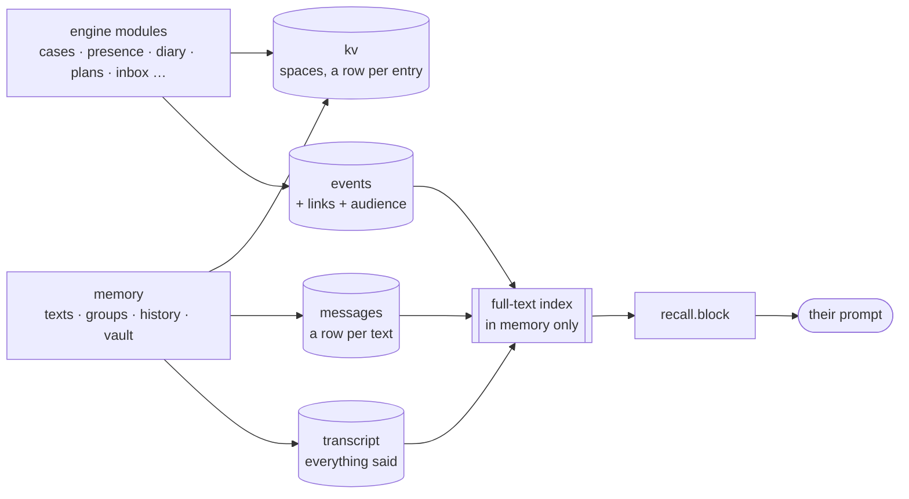

# Storage and recall

Everything the console remembers lives in one SQLite file, `data/wayne.db`. This page is the map: what's kept where, how it's read and written, how the old JSON files came in, and how recall finds what someone would remember. Each module's docstring has the detail.

## Why it moved

The JSON files were read whole, decrypted and parsed on every look, and rewritten whole, with an fsync, on every change. Three things suffered as the world grew:

- **Writes.** One word to Tim rewrote his week of trips. One text rewrote a 2,000-message thread.
- **Hot reads.** Who's on what was asked hundreds of times a pulse, and each answer re-read the board.
- **Memory.** Nothing older than the model's 60-message window could be found, and what happened wasn't connected to who it happened to or who'd heard about it.

Measured on a world grown to a few months of use, against the JSON code:

| | JSON | SQLite | |
|---|---|---|---|
| unread texts, everyone | 6.98 ms | 0.02 ms | 349× |
| last text, everyone | 6.82 ms | 0.04 ms | 170× |
| who's on what (×90) | 58.95 ms | 0.29 ms | 201× |
| sending a text | 2.54 ms | 0.06 ms | 45× |
| a group message | 2.73 ms | 0.19 ms | 14× |
| marking a case | 2.31 ms | 0.03 ms | 89× |
| a prompt's background | 1.90 ms | 0.26 ms | 7× |
| the map's dots, everyone | 8.87 ms | 2.73 ms | 3.3× |

## The tables

| table | what | written by |
|---|---|---|
| `kv` | Named **spaces** of small JSON documents, a row per entry, kept in insertion order (`seq`). | `wayne/store/kv.py` |
| `messages` | Every text (`dm:<contact>`) and group message (`g:<group>`), a row each. Sender, time, kind and the read marks have their own columns; the rest is sealed JSON. | `wayne/store/threads.py` |
| `transcript` | Everything said with each contact, a line a row, kept past the window (`WAYNE_TRANSCRIPT_DAYS`, 90). | `wayne/store/transcript.py`, from `History.save` |
| `events` | What happened, a line each: `diary.*`, `hearsay`, `case.closed`, `plan.made`, `rogue.*`. `scope` (private, watchers or public) and `secret` (the masks' business) decide who else may know it. | `wayne/store/events.py` |
| `event_links` | What an event is about: `(contact, robin)`, `(case, id)`, `(rogue, The Joker)`, `(place, …)`, `(plan, id)`. | events |
| `event_audience` | Who knows an event, from when, and how ("Dick told you"). Hearsay reaches its audience later than it happened. | events |
| `quarantine` | Any sealed value that wouldn't open with the current key, kept so it can be recovered. | `wayne/store/seal.py` |
| `meta` | When it was imported, what from, and when upkeep last ran. | |

### The spaces

| space | one entry per | module |
|---|---|---|
| `cases` | case | `engine/cases.py` |
| `plans` | plan | `engine/plans.py` |
| `mail`, `mail_keys`, `mail_events` | message, delivery key, event waiting for its mail | `engine/inbox.py` |
| `presence/<contact>` | state key (`activity`, `trips`, `intents`, …) | `engine/presence.py` |
| `window` | contact: the model's conversation window | `memory/history.py` |
| `vault/<contact>`, `story/<contact>` | fact | `memory/vault.py` |
| `groups` | group: its settings and read pointers | `memory/groups.py` |
| `diary_last` | contact: what the diary last saw | `engine/diary.py` |
| `dispatch`, `reportlog` | scanner report | `engine/incidents.py` |
| `rogue_status`, `encountered` | rogue | `engine/codex.py` |
| `codex_notes`, `frames`, `place_edits` | note, portrait framing, place | `engine/codex.py`, `engine/places.py` |
| `culture`, `gazette` | contact; day | `engine/culture.py`, `engine/gazette.py` |
| `bio`, `mutes`, `pins` | contact; thread; pin | `frontends/web.py` |
| `doc` | single document: `bruce`, `jet`, `arcs`, `initiative` | `store.doc()` |

## Reading and writing

- **Reads come from memory.** A space is loaded once and cached as each entry's JSON text.
  - `get`, `list` and `dict` return fresh copies, to change as you like, the way a file read did.
  - `view` and `view_dict` return one shared object, parsed once per change, for hot read-only paths: `cases.peek()`, the scanner's dispatches, the plan check in every routine. Never change it; copy what you hand on. A test guards this.
- **Writes touch only what changed.**
  - `put` writes nothing if the value is unchanged.
  - `replace(mapping)` diffs against the cache, so `Presence.save()` writes only the keys that moved.
  - `cases` writes the one case it changed.
- **One connection per database, one re-entrant lock** (`wayne/store/db.py`). SQLite is built serialised, so the event loop, worker threads and the grapevine's daemon all share it safely.
  - `with db.tx():` is `BEGIN IMMEDIATE … COMMIT`. Nested transactions join the outer one, and caches touched in a transaction that rolls back are dropped.
  - Never call the model or the network inside a transaction.
- **Other processes** (a script, a second console) are handled by WAL and a busy timeout. Their writes are noticed through `PRAGMA data_version`, checked at most every half second, which drops the caches and rebuilds the search index.
- **Tests get a database each:** `conftest.py` points `DATA_DIR` at a fresh temporary folder per test. Under pytest, `store.get()` refuses to open the real `data/`.

## Sealing

With `WAYNE_MEMORY_KEY` set, every value is Fernet-encrypted on its own; without it, values are stored as plain UTF-8.

- **Turning the key on loses nothing.** A database written before the key still reads, and each row is sealed as it's next written. `scripts/migrate_to_db.py --reseal` seals everything now.
- **A wrong key quarantines rather than loses.** A value that won't open is copied to `quarantine` before it's treated as missing.
- **Plain on purpose:** ids, times, kinds and read marks, about what a directory listing showed before.
- **The full-text index is only ever in memory**, because it stores words in the clear.

## Coming in, going back, starting over

- **First start:** `legacy.adopt` imports an older console's JSON files.
  1. Every file is read with `decrypt`, which, unlike `read_text`, moves nothing aside.
  2. Everything is written in one transaction.
  3. It's all read back through the same module APIs and compared with the files. Any difference rolls everything back and sets the empty database aside as `wayne.failed-<when>.db`.
  4. Only then are the files moved, untouched, into `data/_imported-<when>/`.
  5. A file that won't open is left where it is, listed under `import_skipped`, and the import goes ahead without it.
- **`scripts/export_db_to_json.py`** writes the old files back out: to `_exported-<when>/`, `--to DIR`, or `--in-place` for running an older version on the same data.
- **`scripts/migrate_to_db.py`** shows status, `--now`, `--check` (integrity, contents, quarantine) and `--reseal`.
- **`scripts/reset_world.py --all | --chats | --world`** clears spaces and event kinds, after copying the data directory (the database by the backup API).
- **Daily upkeep** (`wayne/store/upkeep.py`, at start and from the pulse):
  - clears transcript and events past their retention;
  - runs `PRAGMA optimize` and a checkpoint;
  - copies the whole database into `data/_backup-daily/`, keeping a week of copies (`WAYNE_BACKUPS`).

## Recall

`recall.block(contact, prompt, said_since, outsider)` returns a few lines of what they'd remember, or `''`. `session._ask` adds it to the reference block for every turn, and `group_post` adds it when someone in the chat reaches back.

1. **Gate.** It looks only when there's a memory cue ("remember", "did you…", "what happened", "did you hear"), a time ("last night", "on Tuesday", "the other day"), or a rogue named. Naming a family member isn't enough on its own. Most turns cost nothing.
2. **Candidates** come from three places:
   - the in-memory FTS5 index (`wayne/store/index.py`; BM25, each hit scored against the best and weak ones dropped);
   - every event and transcript line in the time asked about;
   - events linked to whoever was named.
3. **Visibility**, per viewer:
   - an event they're in the audience of, once `known_at` has passed;
   - `public` events;
   - `watchers` events if they watch the screens (Alfred, Barbara);
   - their own transcript;
   - group messages between when they joined and how far they've read.

   Anyone outside the secret, or anyone on a call or in a chat with someone who is, gets nothing that touches the masks. The city's public news is the exception.
4. **Nothing repeated:** the window in front of them, the last three hours of their own diary, hearsay still in `grapevine.block`, or the last three hours of their group chats.
5. **Score:** lexical fit, recency (a half-life per kind), whether it falls in the time asked about, whether it's linked to who was named, and a little extra for a case. Near-duplicates are dropped. A question about a stretch of time ("last night") is answered start to end rather than with the first five lines.
6. **Render:** at most five lines and `WAYNE_RECALL_WORDS` words, in time order, said the way people say when ("last night", "on Tuesday", "2 weeks ago").
   - A transcript hit comes with the other half of its exchange.
   - The block names itself as their memory, in the same words as the standing rule that tells them to deny conversations they can't see. Without that, the model denied memories that were right in front of it.

Cost: 2–10 ms on a turn that asks, with an index of about 10,000 rows built in 35 ms.

**Testing it:**

- `tests/test_recall.py` covers time phrases, gating, exchanges, hearsay timing, the secret, watchers, group read pointers, the budget and links.
- In the eval, a scenario can say what a contact remembers (`"remembers"`: a past exchange, a diary line, news that reached them, a case, the city's news). It's seeded for that scenario only, and the judge is told it's true. See `eval/scenarios/memory.json`.
